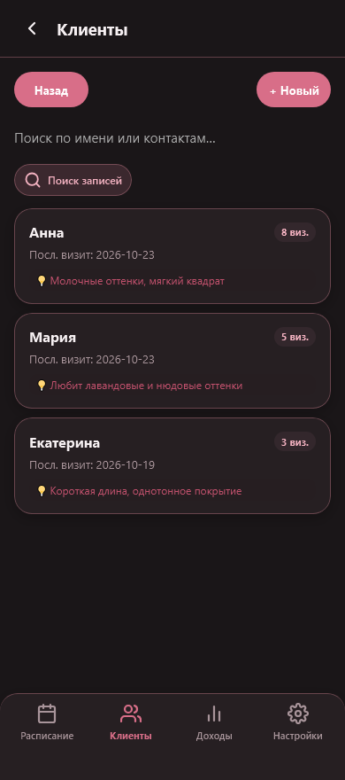
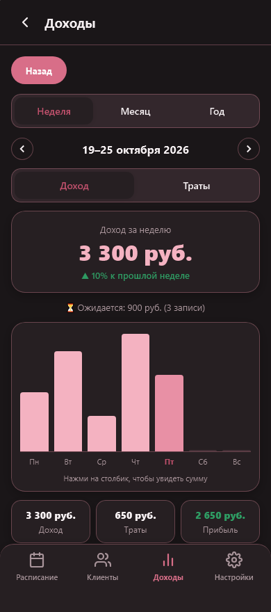

# 💅 NailBook

**Ежедневник мастера маникюра и педикюра прямо в Telegram.**

Расписание, клиенты и финансы в Mini App. Бот напоминает о завтрашних визитах и присылает резервные копии.

[](https://github.com/lmellory/nail-planner/actions/workflows/ci.yml)

[Возможности](#возможности) · [Интерфейс](#интерфейс) · [Запуск](docs/development.md) · [Обслуживание](docs/operations.md) · [Архитектура](docs/architecture.md)

## Возможности

| Раздел | Что можно делать |
| --- | --- |
| **Расписание** | Листать неделю, открывать календарь, находить свободные окна, создавать и переносить записи. |
| **Записи** | Выбирать услугу и покрытие, указывать цену и пожелания, отмечать отмену или неявку. Пересечения по времени показываются до сохранения. |
| **Клиенты** | Хранить контакты, предпочтения и дни рождения, смотреть историю визитов, быстро записывать повторно. |
| **Финансы** | Смотреть доходы, ожидаемые суммы, траты на материалы и прибыль за неделю, месяц или год. Выгружать отчёт в CSV. |
| **Бот** | Получать расписание на завтра, сообщения о новых записях, заметки и напоминания о днях рождения. |
| **Настройки** | Задавать график работы, часовой пояс, время уведомлений и прайс услуг. |
| **Резервные копии** | Сохранять данные в JSON вручную или получать копию раз в неделю; восстанавливать после просмотра отчёта. |

У каждого мастера своё расписание и данные. Администратору доступны управление доступом, диагностика и работа с записями выбранного мастера.

## Интерфейс

Пудрово-розовая палитра, светлая и тёмная темы, нижняя навигация. Интерфейс адаптирован для телефона и компьютера.

<table>
  <tr><th>Расписание</th><th>Клиенты</th><th>Доходы</th></tr>
  <tr>
    <td></td>
    <td></td>
    <td></td>
  </tr>
</table>

На снимках — настоящий интерфейс с вымышленными демонстрационными данными. Рабочая база для них не используется.

## Удобство в ежедневной работе

- Время и имя клиента выделены в карточке, подробности остаются рядом.
- Кнопка показывает ход сохранения и защищает от повторного нажатия.
- При ошибке заполненные поля остаются в форме.
- При выходе с несохранёнными изменениями появляется предупреждение.
- Будущие записи показываются как ожидаемый доход; отмены и неявки в доход не входят.
- Уведомления о новых записях и заметках удаляются из чата через сутки. Сами данные сохраняются в приложении.

Суммы хранятся целыми числами в валюте мастера. Текущая подпись — «руб.», в этом проекте используются рубли ПМР; автоматической конвертации нет.

## Технологии

| Слой | Стек |
| --- | --- |
| Сервер | TypeScript, Hono, Cloudflare Workers |
| Данные | Turso / libSQL, SQL-миграции, транзакции |
| Интерфейс | JavaScript ES modules, HTML, CSS; без сборщика |
| Telegram | Mini App, webhook бота, фоновые задачи Cron |
| Проверки | Vitest, SQLite, jsdom, Playwright — Chromium и WebKit |

## Начать работу с кодом

Нужен Node.js **22.12+ в ветке 22, ветка 24 или 26+**, согласно `package.json`.

```bash
npm ci
npm run typecheck
npm test
```

Эти проверки используют временные тестовые базы и не требуют доступа к рабочей Turso. Для локального приложения нужны отдельная база и настройки Telegram — см. [инструкцию запуска](docs/development.md).

## Документация

| Документ | Содержание |
| --- | --- |
| [Разработка и публикация](docs/development.md) | Переменные окружения, локальный запуск, миграции, тесты, деплой и webhook. |
| [Обслуживание и восстановление](docs/operations.md) | Резервные копии, диагностика, обновление и возврат версии приложения. |
| [Команды бота и доступ](docs/bot.md) | Команды мастера, администратора и наблюдателя. |
| [Архитектура](docs/architecture.md) | Структура файлов, границы модулей и правила работы с данными. |

Проверки запускаются в [GitHub Actions](https://github.com/lmellory/nail-planner/actions) при каждом push и pull request. Браузерные сценарии покрывают мобильные и настольные размеры, медленную сеть, ошибки сохранения и защиту несохранённых форм.
